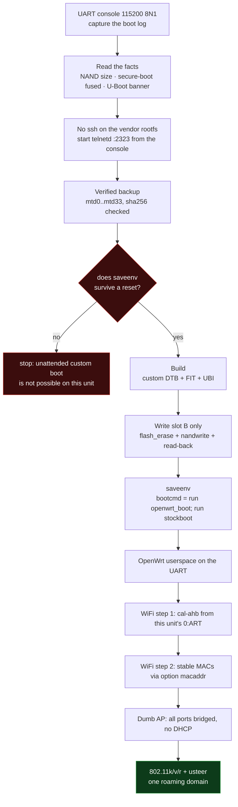
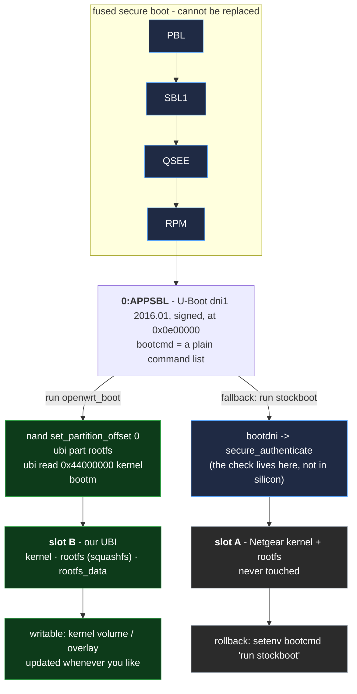
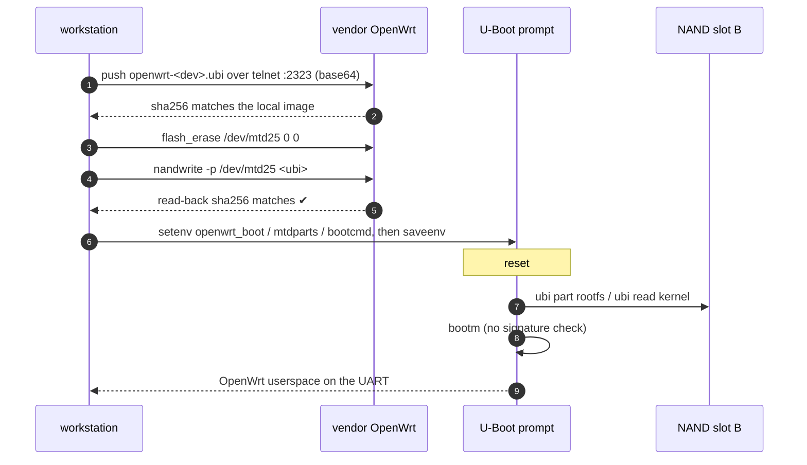

# OpenWrt on the Netgear Orbi Pro WiFi 6 Mini (SXR30 / SXS30) - community porting kit

This is the *reusable* half of a hardware port that was actually performed on two units: a Netgear
Orbi Pro WiFi 6 Mini **SXR30** (router) and its satellite **SXS30** - both Qualcomm **IPQ6018**
("starling") boards with fused secure boot.  It explains and scripts:

* getting a root shell (UART, then a network transfer channel),
* a verified, bad-block aware full NAND backup,
* building an upstream **OpenWrt** image that the **vendor U-Boot** will boot (unsigned kernel, the
  fused secure boot never enters the picture),
* installing it **only into the inactive A/B slot**, with the stock system one command away,
* making WiFi work (per-unit calibration from `0:ART`, board file, MACs),
* turning the box into a wired "dumb AP" with 802.11k/v/r so two Orbis form one roaming domain.

Everything here is generic: no site-specific addresses, credentials, MACs or serial numbers.  Nothing
in this folder contains data from the units used for the port.

> **This is not a vendor-supported procedure.**  It writes to NAND on hardware that **cannot be
> recovered by USB** - if you damage the bootloaders (`0:SBL1`, `0:APPSBL`, `0:ART`,
> `boarddata*`) the device is bricked for good.  Read `GOTCHAS.md` before you touch anything, and take
> the full backup first.

## The procedure at a glance



## Why an unsigned kernel boots: the boot chain



The secure-boot check is **implementation, not silicon**: `bootdni` calls `secure_authenticate`, and the
vendor's `bootcmd` is just a command list.  Replacing the *commands* (a saved environment) skips the
check entirely - which is why the kernel in slot B never needs a Netgear signature.  The bootloader
itself is verified by the fused chain and is left alone.

## The write path (nothing else on the NAND is touched)



## What is proven vs. what is not

| | status |
|---|---|
| vendor U-Boot boots an **unsigned** aarch64 OpenWrt kernel (`bootm` + FIT) | **proven on hardware** |
| persistent install in slot B (UBI: kernel/rootfs/rootfs_data, ~74 MiB overlay) | **proven** (two units) |
| stock system in slot A untouched, rollback with one `setenv` | **proven** |
| both radios working (5 GHz HE80 + 2.4 GHz HE20) with per-unit calibration | **proven** |
| all four GbE ports working (QCA8075 + `qca-ppe`) | **proven** |
| LuCI, apk packages, SSH keys, 802.11k/v/r, usteer | **proven** |
| booting OpenWrt *without* keeping the vendor U-Boot | **not possible** (fused secure boot verifies `0:APPSBL`) |
| upstream `sysupgrade` flow | **not applicable** (this is a custom FIT+UBI, updated by rewriting the UBI volumes) |

## Files

```
README.md                     this file
GUIDE.md                      step-by-step porting procedure (recon -> backup -> build -> install -> wifi)
GOTCHAS.md                    the traps, with symptoms and fixes (read this twice)
HARDWARE.md                   measured hardware/partition/boot facts for both variants
scripts/                      the toolkit (see scripts/README.md)
```

## Quick start (if you already know what you are doing)

```bash
# 0. working directory: anything writable; it holds work/ and dumps/
export WORKDIR=$PWD

# 1. serial console (115200 8N1) - capture everything
scripts/start-capture.sh 3600 /dev/ttyUSB0

# 2. get a root shell on the LAN without ssh (the stock rootfs has no dropbear)
scripts/net-shell.sh                     # UART -> passwordless "telnetd -l /bin/sh -p 2323"
export ORBI_TARGET_IP=<vendor-system-ip>

# 3. verified full backup (mtd0..mtd33; mtd34 is the union of them)
python3 scripts/dump.py dumps 0-33

# 4. prove that the U-Boot environment persists on *your* unit (2 reboots)
#    at the IPQ6018# prompt: setenv orbi_test 123; saveenv  -> reset -> printenv orbi_test
python3 scripts/uboot.py --sep '@@' --cmds "setenv orbi_test 123@@saveenv"

# 5. upstream artifacts, then the image set for your board variant
scripts/fetch-openwrt-artifacts.sh
DEV=sxr30 scripts/openwrt-build-image.sh        # router  (512 MiB NAND, slot B @0x8800000)
DEV=sxs30 scripts/openwrt-build-image.sh        # satellite (256 MiB NAND, slot B @0x6600000)

# 6. install into the inactive slot B, verify, then point U-Boot at it
scripts/openwrt-install-telnet.sh sxr30 $ORBI_TARGET_IP
DEV=sxr30 scripts/openwrt-set-bootcmd.sh

# 7. first boot: console shell.  Then create the calibration file (see GUIDE step 7) and reboot.
# 8. configure as dumb AP / roaming AP (see GUIDE step 8)
```

## Getting help / reporting

The port was done by reading a lot of the vendor stack: `parse_dni_image.py` (image container
layout), `openwrt-ubi-parse.py` (raw UBI inspector), `uboot.py` (drives the bootloader prompt) and
`dump.py` (verified backup) are the tools that produced the facts in `HARDWARE.md`.  If something
does not match your unit, re-derive it with those instead of trusting the notes.
